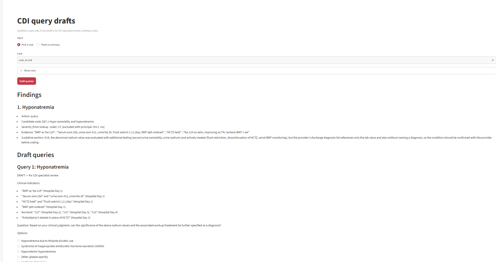

# CDI Query Assistant (GBUS 562 Capstone)

## What It Does

Hospitals are paid, and their quality is measured, based on how completely a patient's chart documents their conditions. Clinical Documentation Integrity (CDI) specialists review inpatient charts to find conditions the evidence supports but the physician never clearly documented. The ones that matter most are complications or comorbidities (CCs) and major CCs (MCCs). When they find one, they send the physician a *query* asking for clarification. Doing this by hand is slow and inconsistent. A badly worded query that suggests the answer (a "leading" query) also creates compliance risk.

This tool is for CDI specialists. Given a discharge summary and its current ICD-10-CM codes, it:
- lists evidence-supported CC/MCC candidates, quoting the chart and citing the ICD-10-CM Official Guidelines;
- states each code's severity only as the official CMS CC/MCC table gives it;
- drafts non-leading physician queries for the specialist to review.

It is **draft-only**: nothing is ever sent to a physician. **All patient data is synthetic.** The reference material is public U.S. government data (CDC, CMS).

**How it works.** A case file goes to Claude (`claude-sonnet-5` by default) in a tool-use loop. Claude chooses which of three local tools to call, up to 12 calls per case:
- `search_guidelines`: semantic search (Chroma) over the FY 2027 ICD-10-CM Official Guidelines;
- `search_codes`: finds candidate codes in the CMS FY 2027 CC/MCC table;
- `lookup_code`: returns a code's exact severity, and whether the principal diagnosis excludes it.

Claude then writes a **Findings** section and a **Draft queries** section, following a system prompt and the project's physician-query standards. Code checks the answer: every quote must appear in the chart, and every stated severity must come from a `lookup_code` call in that run. Each request is appended as one JSON line to `runs/log.jsonl`, with its input, output, token counts and time.

```
case file ──► Claude agent ◄──► search_guidelines (guidelines index)
                   │       ◄──► search_codes / lookup_code (CMS CC/MCC table)
                   ▼
        Findings + Draft queries ──► code checks ──► printed output + runs/log.jsonl
```

## Demo

Video: [VIDEO LINK GOES HERE]



## How to Run

You need Python 3.10 or newer (built with 3.13) and an Anthropic API key.

**1. Create a virtual environment and install packages.** From the repository root:

```
python -m venv .venv
.venv\Scripts\activate            # Windows
source .venv/bin/activate         # macOS / Linux
pip install -r capstone/requirements.txt
```

**2. Put your API key in `API-Key.txt`, one folder *above* the repository root**, never inside the repository:

```
some-folder/
├── API-Key.txt            ← your Anthropic API key, on one line
└── gbus562-coursework/    ← this repository
    └── capstone/
```

The tool reads the key at run time and never prints it or writes it to any file. `.gitignore` also excludes any file named `API-Key.txt`.

**3. Build the reference data** (one time, no API calls). This writes `reference/cc_mcc.csv` from the CMS tables, builds the guideline search index in `.chroma/`, and checks both:

```
cd capstone
python build_reference.py
```

**4. Review a case:**

```
python cdi_query.py data/cases/case_03.md
python cdi_query.py data/cases/case_03.md --model claude-opus-5-5
```

**5. Evaluate against the answer key** (`data/answer_key.json`). Each case is a real, logged API request. The report is printed and saved to `runs/eval_<timestamp>.md`.

```
python eval.py --split dev                  # cases 01–14; also: --split test or --split all
python eval.py --split test --model claude-sonnet-5 claude-opus-5-5
```

Optional: a local web page with `streamlit run app.py --server.address localhost --server.headless true`, then open http://localhost:8501.

More detail: `docs/project_log.md` (design, decisions and file list), `docs/model_comparison.md`, `docs/dev-run-review.md`, and `reference/SOURCES.md`.
